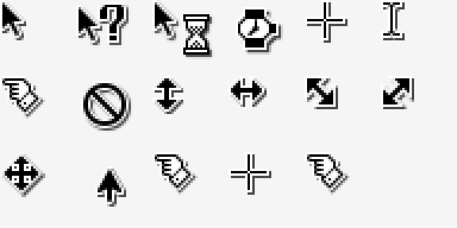

# KDE Classic Cursors for Windows


把 KDE 3.x 及更早版本的经典鼠标指针（就是 KDE 里那个 **KDE Classic** 主题）移植到 Windows 10/11。
源素材来自 [na0miluv/kde-classic-cursors](https://github.com/na0miluv/kde-classic-cursors) 的 SVG 重制版，本项目把它们编译成 Windows 能直接安装的 `.cur` + `install.inf`。

> A faithful Windows port of the classic KDE 3.x / **KDE Classic** pointer set, built from the remastered SVG sources of [na0miluv/kde-classic-cursors](https://github.com/na0miluv/kde-classic-cursors).



## 安装 Installation

1. 下载本仓库（`Code → Download ZIP` 或 [Releases](../../releases/latest) 里的 `KDE-Classic-Cursors-v1.1.0.zip`）并解压。
2. 右键 `install.inf` → **安装**（Windows 11 需先点「显示更多选项」）。
3. `Win + R` → 输入 `main.cpl` → **指针** 标签 → 方案下拉框选 **KDE Classic** → **应用**。

```text
注意：.inf 只负责把指针拷进 C:\Windows\Cursors\KDE Classic 并登记方案，
      它不会自动切换。必须在「鼠标属性 → 指针」里选中方案再点应用。
      Windows 11 新版「设置」不显示自定义方案，务必用 main.cpl。
```

**卸载 / Uninstall**：删除 `C:\Windows\Cursors\KDE Classic` 目录，再删除注册表
`HKCU\Control Panel\Cursors\Schemes` 下的 `KDE Classic` 值即可。

## 高 DPI

每个 `.cur` 内含 **32 / 48 / 64 px** 三档图像，Windows 会按 DPI 自动挑最合适的一档，不会糊。
如果觉得整体偏小：设置 → 辅助功能 → 鼠标指针和触控 → 指针大小。

## 包含的角色 Included roles

| Windows 角色 | 文件 | 来源 SVG |
|---|---|---|
| Normal Select | `arrow.cur` | `default.svg` |
| Help Select | `help.cur` | `help.svg` |
| Working In Background | `appstarting.cur` | `progress.svg` |
| Busy | `wait.cur` | `wait.svg` |
| Precision Select | `crosshair.cur` | `crosshair.svg` |
| Text Select | `ibeam.cur` | `text.svg` |
| Handwriting | `nwpen.cur` | `pointer.svg` |
| Unavailable | `no.cur` | `not-allowed.svg` |
| Vertical Resize | `sizens.cur` | `size_ver.svg` |
| Horizontal Resize | `sizewe.cur` | `size_hor.svg` |
| Diagonal Resize 1 | `sizenwse.cur` | `size_fdiag.svg` |
| Diagonal Resize 2 | `sizenesw.cur` | `size_bdiag.svg` |
| Move | `sizeall.cur` | `fleur.svg` |
| Alternate Select | `uparrow.cur` | `up-arrow.svg` |
| Link Select | `hand.cur` | `pointer.svg` |
| Location Select | `pin.cur` | `crosshair.svg` |
| Person Select | `person.cur` | `pointer.svg` |

## 技术细节 Technical notes

- 每帧都是 **32bpp BMP DIB**（含 alpha 通道 + AND 掩码），不用 PNG-in-CUR，兼容性最好。
- 热点（hotspot）直接取自上游 `src/config/*.cursor`，按 `32 → 48/64 px` 等比缩放，不是拍脑袋估的。
- 所有 `.cur` 都通过 Windows `LoadCursorFromFile` / `GetIconInfo` 实机校验，热点读回值与配置一致。

## 已知差异 Known differences

- **Busy / Working 指针是静态的**：上游只有单帧 SVG（原版沙漏本身也基本是静态），所以没做 `.ani` 动画。
- **Handwriting / Location Select**：KDE 没有对应角色，分别近似映射到 `pointer` 和 `crosshair`。
- 没有包含 Windows 的「文字垂直选择」等 KDE 里不存在的角色。

## 目录结构 Layout

```text
install.inf            安装入口（17 个角色）
*.cur                  17 个 Windows 指针（32/48/64 px）
preview.png            预览图
tools/build_cursors.py 从 SVG 源重新生成整套 .cur + install.inf
x11-names/             上游完整 48 个 X11 角色名（仅参考，Windows 用不到）
```

## 重新构建 Rebuild

需要 Inkscape（命令行可用）与 Python 3.10+：

```powershell
git clone https://github.com/na0miluv/kde-classic-cursors.git src
uv run --with pillow python tools/build_cursors.py --svg src/src/svg --config src/src/config --out .
```

## 版本历史 Changelog

### v1.1.0
- 全部指针改为 **32bpp BMP DIB** 编码（不再用 PNG-in-CUR），并内置 32/48/64 px 三档，修掉高 DPI 模糊
- 按上游 `src/config/*.cursor` 校正热点：`wait` 16,16 → **12,12**、`crosshair` 12,12 → **9,9**、`help` 1,5 → **1,4** 等
- `install.inf` 改为 `REG_EXPAND_SZ`（`0x00020000`）方案值，安装后方案可直接被 Windows 解析
- 新增 `tools/build_cursors.py`，整套产物可复现
- 仓库根目录改为 17 个 Windows 角色；旧的 48 个 X11 角色名移至 `x11-names/` 保留
- 明确许可：CC0-1.0

### v1.0.0
- 首版：48 个 X11 角色名的单帧 32px 指针

## 许可 License

上游 [na0miluv/kde-classic-cursors](https://github.com/na0miluv/kde-classic-cursors) 以 **CC0 1.0 Universal**（公有领域贡献）发布，本项目作为其衍生作品同样以 **CC0 1.0** 发布，见 [LICENSE](LICENSE)。
KDE、Plasma 是 KDE e.V. 的商标；本项目与 KDE e.V. 无隶属关系。

## 致谢 Credits

- 指针美术：KDE 社区（KDE 3.x 及更早版本）
- SVG 重制：[na0miluv](https://github.com/na0miluv)
- Windows 格式转换：本项目（Inkscape 渲染 + BMP Cursor 打包）
